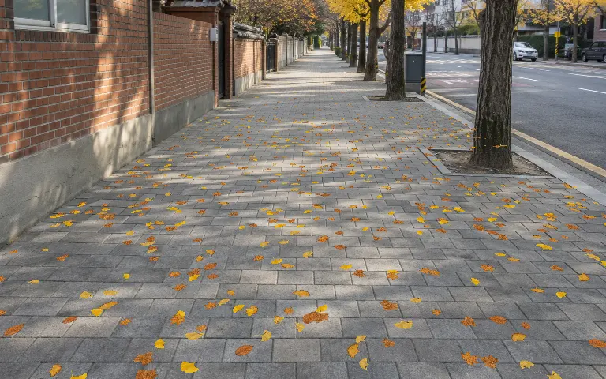

# Sidewalk Wind

An interactive autumn street scene, seen at eye level from a Korean sidewalk. Hold down on the paving and a small whirlwind lifts the leaves. Drag across the path and watch the leaves already in the air travel with it, picking up others along the way.



## Run locally

Open `index.html` in a browser. The page works offline and needs no build step or package installation.

| Input | Action |
| --- | --- |
| Mouse or touch | Press and hold on the paving to sustain the wind. Drag to steer it. Release to let it coast and fade. |
| Keyboard | Tab to the scene, then hold Enter or Space to stir the leaves in front of you. Release the key to let them settle. |
| Pause button | Pause or resume the scene. If your device requests reduced motion, the scene starts paused. |

## How the wind moves

The scene tracks 900 individual leaves in 3D and draws them on a 2D canvas over a fixed background. The paving, leaves, and shadows share a perspective calibrated to a viewer standing about 1.62 metres above the ground.

Dragging steers a single vortex. Its centre accelerates toward the pointer and carries the surrounding air with it. Airborne leaves pick up that sideways motion while continuing to orbit. Leaves farther along the path stay on the ground until the wind reaches them. On release, the vortex coasts in its last direction as the updraft weakens.

## Project files

| File | Purpose |
| --- | --- |
| `index.html`, `scene.css` | Full-screen scene, Korean controls, and accessible instructions |
| `scene.js` | Input, animation loop, and canvas rendering |
| `wind.js` | Perspective, vortex movement, and leaf dynamics |
| `wind.test.cjs` | Deterministic checks for pickup, sustained rotation, transport, and landing |
| `assets/` | Street backdrop, six leaf cutouts on one texture sheet, and the animated preview |

To run the motion checks, use Node.js from this folder.

```sh
node wind.test.cjs
```

## Artwork

The street backdrop and leaf textures are AI-generated images created for this project. The preview shows a drag gesture rendered with the same simulation and drawing code as the interactive page.
